# Architecture Report

## Repository Information

**Repository Name:** study-coach

**Technology Stack:**

- Node.js
- React

---

## Executive Summary

[//]: # (summary:start)

A local study coach for Microsoft certification exams, starting with AZ-104: AI instructors teach each skill and the learner practises with original, documentation-checked questions.

The model of Study Coach describes 3 containers, 3 data stores, 3 external systems, 2 people, 13 relationships and 2 key flows.

[//]: # (summary:end)

The automated dependency checks found no structural concerns.

---

[//]: # (c4:start)

## Architecture overview

Study Coach is a single-user application run locally. A React web app talks to one Node server that hosts a Flue Coach agent (a lead instructor delegating to per-area specialist subagents) and a Hono JSON API over a SQLite database. A separate command-line pipeline syncs the Microsoft documentation into a local corpus, builds a fact sheet per skill and generates the question bank by running a writer agent once per question, admitting a question only after a leak check and an independent verifier agree with its key. Every model call goes to MiniMax (M3 by default; M3.1 Flash is available). Generation retries a slow or failing question once on a fallback model and logs each call's tokens and cost.

### Findings

- Every role defaults to one provider, `minimax/MiniMax-M3` (`src/coach/models.ts:1`, fallbacks at `src/coach/models.ts:15`). Generation now retries a question that times out or ends in a model error once on a fallback model (`scripts/generate.ts:144`, default at `scripts/generate.ts:261`), but a used-up plan (usage-limit 429) still stops both generation and lessons, and lessons have no fallback at all.
- The server and generation runs share `data/coach.db`; this is handled with WAL and a 5 s busy timeout (`src/coach/db.ts:86-89`). Flue's own store has no such setting, so batch runs avoid it with an in-memory store (`scripts/flue-jobs.ts:107-110`), which means generation conversations are not kept.
- The scaffold `Assistant` agent is still mounted at `/agents/assistant` with a hard-coded model (`src/app.ts:14`, `src/agents/assistant.ts:8`); nothing in the web app uses it.
- There is no authentication on `/api` or `/agents` (`src/app.ts:11-16`); safety rests on the dev server binding to 127.0.0.1 (`package.json:9`). There is no production build or start script, only `vite dev`.
- `src/coach/instructors.ts:4` imports `seed.ts`, which imports `instructors.ts` back (`src/coach/seed.ts:2`). It works because both are used only at call time; a top-level use on either side would break module loading.
- Adding an area touches several places: skills in `src/coach/seed.ts`, instructors in `src/coach/instructors.ts` and `web/src/lib/instructors.ts`, colour tokens in `web/src/styles.css` and diagram nouns in `src/coach/diagram-schema.ts`.
- The lead's tools and hand-overs are gated by a read-only "learner has the floor" flag (`src/tools/coach-tools.ts:185`, `src/agents/coach.ts:68-75`). Flue renders a subagent at delegation time and throws on any state write during a render, so the check must never write. An earlier version wrote there, and every hand-over failed while the evals still passed because they checked only speaker names; the eval now fails on any failed hand-over (`src/evals/coach.eval.ts:91`).
- Generation runs each question as its own `flue run` process (`scripts/flue-jobs.ts:115`), so usage is recorded from inside the agent module through Flue's `observe()` (`src/coach/usage-log.ts:52-60`) and tied to the run by `GENERATE_RUN_ID` (`scripts/generate.ts:208`); the verifier's scratch conversation would otherwise be counted separately.

### Recommendations

- Extend the fallback model to lessons, and to a usage-limit 429, so a used-up plan does not stop lessons.
- Remove the scaffold Assistant route, or stop mounting it, since nothing uses it.
- Keep the server bound to localhost; add authentication before exposing it on any other interface.
- Break the instructors/seed cycle by moving AREAS and SKILLS into a module that imports neither.
- Derive the web instructor list and colours from the server catalog (for example via /api/skills) so a new area is data in one place.

## Architecture (C4 model)

A local study coach for Microsoft certification exams, starting with AZ-104: AI instructors teach each skill and the learner practises with original, documentation-checked questions

### Diagram key

What the shapes and lines in the diagrams below mean.

| Symbol | Meaning |
|---|---|
| Dark blue rounded box | **Person** — a user or a role outside the system. |
| Blue box (Level 1) | **Software system** — the system this report describes. |
| Blue box | **Container** — an application or service that runs on its own. |
| Blue cylinder | **Data store** — a database, cache or queue. |
| Light blue box | **Component** — a module, package or namespace inside one container. |
| Pale dashed box | Used by most of the other components, drawn in another part of the same view, or shared with another container and drawn once in a shared-libraries view. |
| Grey box | **External system** — run by someone else. |
| Dashed grey outline | The system or the container the diagram is about. |
| Solid arrow | A dependency or a call, labelled with what it does and the technology it uses. |

### Level 1: System context


Mermaid source

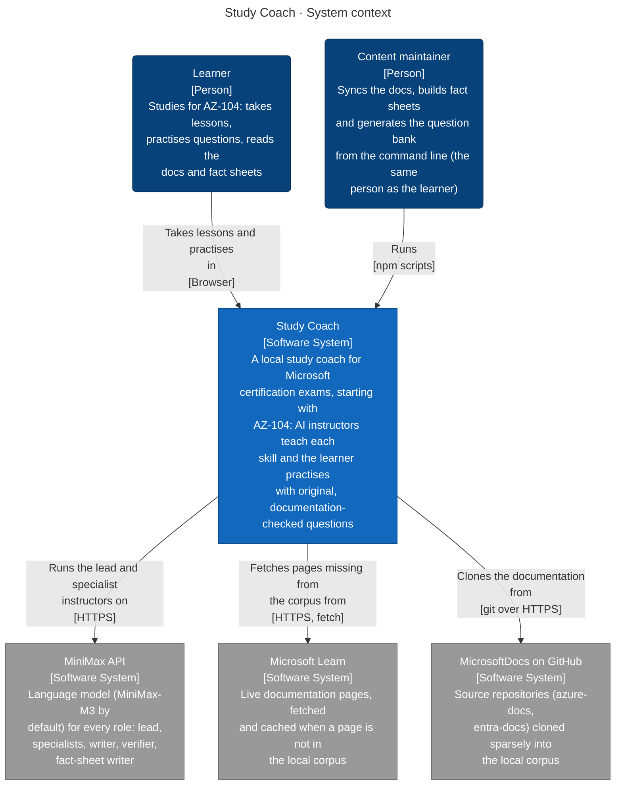

### Level 2: Containers


Mermaid source

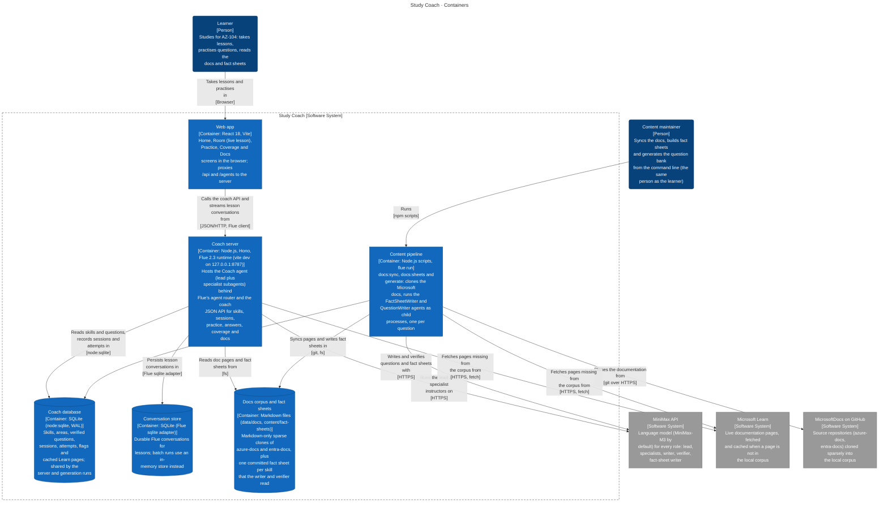

| Container | Technology | Responsibility | Code |
|---|---|---|---|
| **Web app** (container) | React 18, Vite | Home, Room (live lesson), Practice, Coverage and Docs screens in the browser; proxies /api and /agents to the server | — |
| **Coach server** (container) | Node.js, Hono, Flue 2.3 runtime (vite dev on 127.0.0.1:8787) | Hosts the Coach agent (lead plus specialist subagents) behind Flue's agent router and the coach JSON API for skills, sessions, practice, answers, coverage and docs | `.` |
| **Content pipeline** (container) | Node.js scripts, flue run | docs:sync, docs:sheets and generate: clones the Microsoft docs, runs the FactSheetWriter and QuestionWriter agents as child processes, one per question | — |
| **Coach database** (data store) | SQLite (node:sqlite, WAL) | Skills, areas, verified questions, sessions, attempts, flags and cached Learn pages; shared by the server and generation runs | — |
| **Conversation store** (data store) | SQLite (Flue sqlite adapter) | Durable Flue conversations for lessons; batch runs use an in-memory store instead | — |
| **Docs corpus and fact sheets** (data store) | Markdown files (data/docs, content/fact-sheets) | Markdown-only sparse clones of azure-docs and entra-docs, plus one committed fact sheet per skill that the writer and verifier read | — |

### Level 3: Components

For each container: the modules it is built from (when it has several), then the code structure inside them (packages or namespaces and the imports between them).

#### Coach server

> 5 of 10 dependencies are hidden because a longer path already shows them (A → C is left out when A → B → C is drawn). The full list is in the dependency graph appendix.


Mermaid source

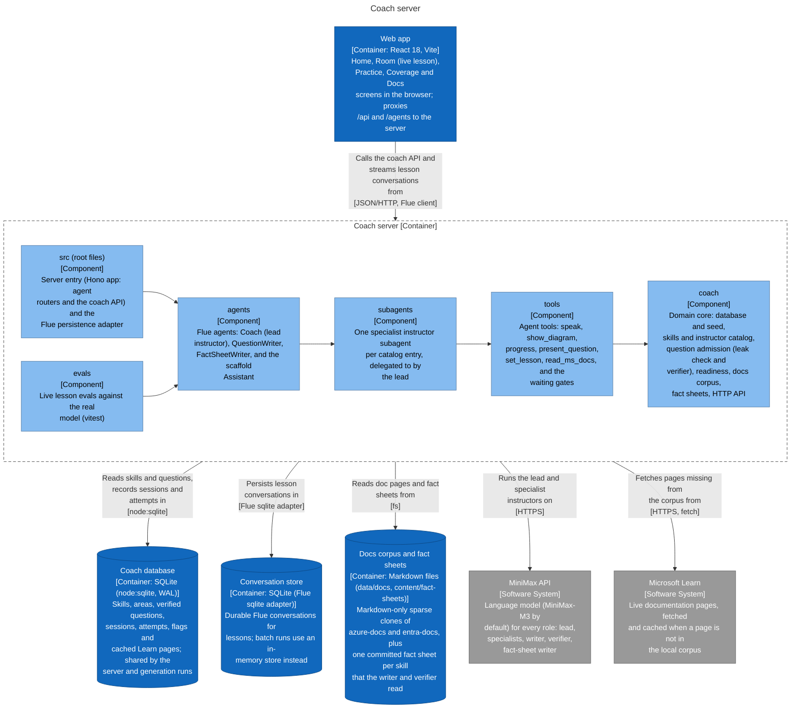

### Level 4: Code

The classes and interfaces of the key components: inheritance, implemented interfaces, dependencies inside the component and public methods. Boxes marked external live in another component.

#### Coach server · src/agents

The lead Coach and the QuestionWriter: hooks, tools and instructions

> Sources: SaveFactSheetDeps → `src/agents/fact-sheet-writer.ts:60`, SaveQuestionDeps → `src/agents/question-writer.ts:36`, SourcePage → `src/agents/fact-sheet-writer.ts:28`, WriterContext → `src/agents/question-writer.ts:215`


Mermaid source

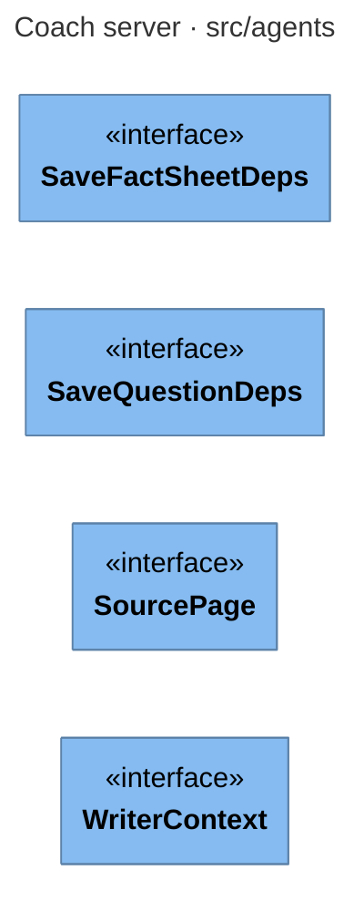

#### Coach server · src/coach

Question admission, persistence and the instructor catalog

> Sources: AdmitDeps → `src/coach/admit.ts:14`, CoachDb → `src/coach/db.ts:6`, CorpusPage → `src/coach/corpus.ts:81`, DocFetchError → `src/coach/docs.ts:5`, DocsApiOptions → `src/coach/docs-api.ts:8`, FactSheet → `src/coach/fact-sheets.ts:16`, MsDoc → `src/coach/docs.ts:14`, PrepareOptions → `src/coach/doc-markdown.ts:6`, PublicQuestion → `src/coach/question-schema.ts:87`, QuestionRow → `src/coach/questions.ts:21`, Readiness → `src/coach/readiness.ts:9`, RenderContext → `src/coach/doc-render.ts:9`
> Not drawn: 11 more types (Skill, SkillProgress, Specialist, StoredSource, SyncState, Token, TurnLike, UnknownQuestionError, UsageEntry, UsageTotals, …)


Mermaid source

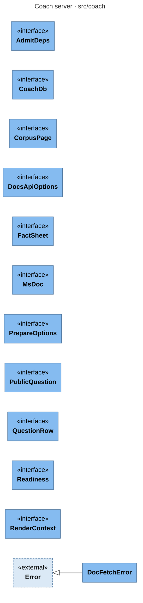

### Key flows

How a request moves through the system, step by step.

#### Learner takes a lesson and answers the check question

From starting a session on Home to the coach reacting to the answer.

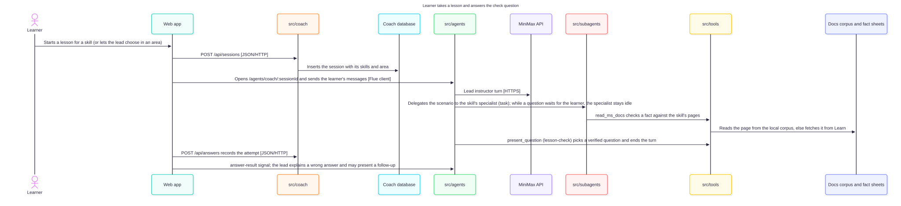

Mermaid source

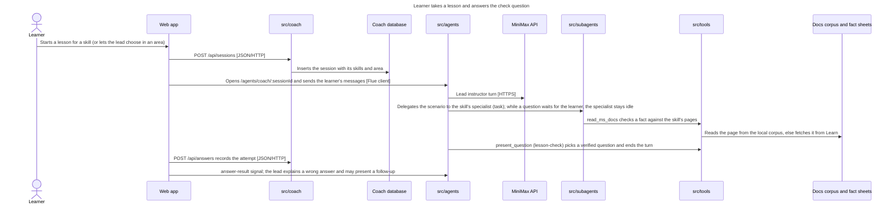

#### Maintainer generates questions for an area

One flue run per question, scheduled per skill; a question is saved only after the leak check and an independent verifier agree with its key.

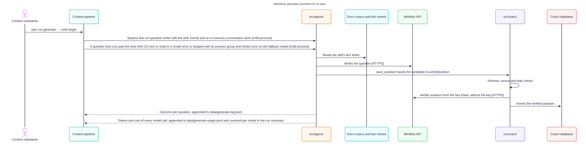

Mermaid source

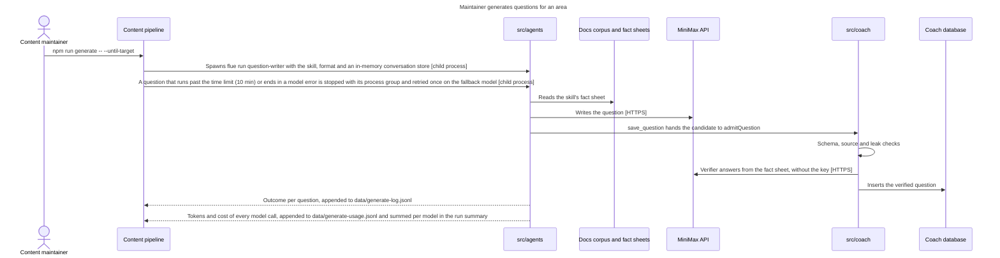

### API endpoints

10 HTTP route(s) declared in code.

**Coach server**

| Method | Path | Declared in |
|---|---|---|
| GET | `/:skillId` | `src/coach/docs-api.ts:24` |
| GET | `/:skillId/page` | `src/coach/docs-api.ts:41` |
| POST | `/answers` | `src/coach/api.ts:168` |
| GET | `/coverage` | `src/coach/api.ts:195` |
| POST | `/practice/next` | `src/coach/api.ts:157` |
| POST | `/questions/:id/flag` | `src/coach/api.ts:183` |
| GET | `/sessions` | `src/coach/api.ts:144` |
| POST | `/sessions` | `src/coach/api.ts:95` |
| GET | `/sessions/:id` | `src/coach/api.ts:151` |
| GET | `/skills` | `src/coach/api.ts:68` |

### Configuration

Config files: `.env`

| Variable | Default | Used by | Declared in |
|---|---|---|---|
| `COACH_DB_PATH` | — | Coach server | `scripts/docs-sheets.ts:59`, `scripts/generate-stats.ts:70`, `scripts/generate.ts:284` |
| `COACH_MODEL` | — | Coach server | `.env:4` |
| `EVAL_SWEEP_AREA` | — | Coach server | `src/evals/coach.eval.ts:230` |
| `FLUE_DB_PATH` | — | Coach server | `src/db.ts:8` |
| `GENERATE_PARALLEL` | — | Coach server | `scripts/docs-sheets.ts:50`, `scripts/generate.ts:251` |
| `MINIMAX_API_KEY` | — | Coach server | `.env:3` |
| `SPECIALIST_MODEL` | — | Coach server | `.env:5` |
| `VERIFIER_MODEL` | — | Coach server | `.env:7` |
| `WRITER_MODEL` | — | Coach server | `.env:6` |

### Technology inventory

Runtime, frameworks and key libraries declared in each container's build files.

| Container | Declared |
|---|---|
| **Coach server** | `@flue/react ^2.3.0`, `@flue/runtime ^2.3.0`, `@flue/sdk ^2.3.0`, `@flue/vite ^2.3.0`, `hono ^4.13.13`, `marked ^15.0.12`, `react ^18.3.1`, `react-dom ^18.3.1`, `sanitize-html 2.18.0`, `valibot ^1.5.0`, `vite ^8.3.4`, `typescript ^7.0.2`, `vitest ^4.1.12` |

### C4 files

- [c4-context.mmd](c4-context.mmd)
- [c4-container.mmd](c4-container.mmd)
- [c4-component-study-coach.mmd](c4-component-study-coach.mmd)
- [c4-flow-lesson.mmd](c4-flow-lesson.mmd)
- [c4-flow-generate.mmd](c4-flow-generate.mmd)
- [c4-code-study-coach-src-agents.mmd](c4-code-study-coach-src-agents.mmd)
- [c4-code-study-coach-src-coach.mmd](c4-code-study-coach-src-coach.mmd)
- [c4-facts.json](c4-facts.json)
- [c4-model.json](c4-model.json)

[//]: # (c4:end)

---

## Architectural Observations

### Strengths

[//]: # (strengths:start)

- Every container, data store and external system found in the code is in the model.
- Every container says what it is responsible for.
- Every component says what it does.
- The model names who the system is for: Learner and Content maintainer.
- 2 key flows are written down end to end: Learner takes a lesson and answers the check question and Maintainer generates questions for an area.
- Every container and external system points at the code that proves it.
- No circular project references.

[//]: # (strengths:end)

### Concerns

No automated concerns detected.

---

## Recommendations

No changes recommended from the automated checks. Review the diagram for boundaries the checks cannot see.

---

## Appendix: Project Dependency Graph

Every project or module and every reference between them, tests included. The automated checks above (cycles, stray projects, untested projects) are based on this graph.

**Solutions / build roots:** none found

**Project folders:** none

Full dependency graph


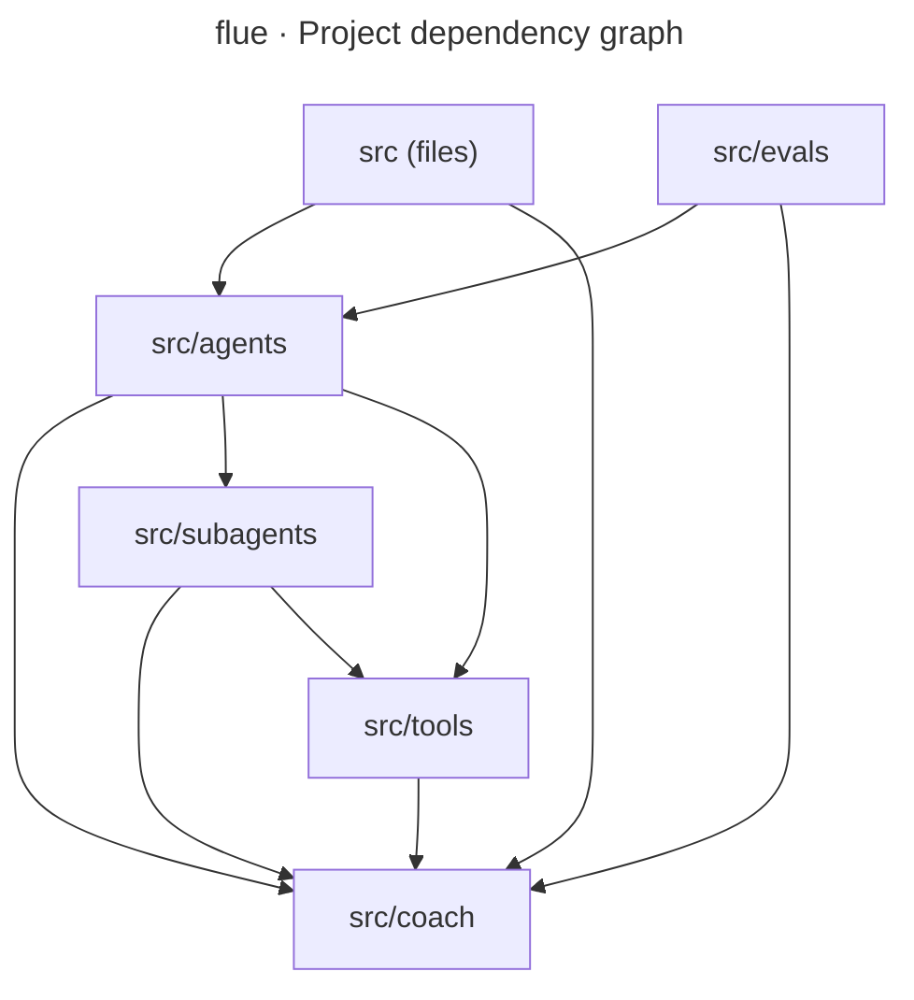

### Components

| Project | Ecosystem | Folder | Kind | Depends on | Used by |
|---|---|---|---|---|---|
| src (files) | Node.js | - | production | 2 | 0 |
| src/agents | Node.js | - | production | 3 | 2 |
| src/coach | Node.js | - | production | 0 | 5 |
| src/evals | Node.js | - | production | 2 | 0 |
| src/subagents | Node.js | - | production | 2 | 1 |
| src/tools | Node.js | - | production | 1 | 2 |

### Dependency Analysis

### src (files)
- depends on src/agents
- depends on src/coach

### src/agents
- depends on src/coach
- depends on src/subagents
- depends on src/tools
- used by src (files), src/evals

### src/coach
- no project references
- used by src (files), src/agents, src/evals, src/subagents, src/tools

### src/evals
- depends on src/agents
- depends on src/coach

### src/subagents
- depends on src/coach
- depends on src/tools
- used by src/agents

### src/tools
- depends on src/coach
- used by src/agents, src/subagents

---

## Generated Artifacts

- [Diagram image (SVG)](dependency-graph.svg)
- C4 diagrams: listed under Architecture (C4 model) above
- [Mermaid source](dependency-graph.mmd)
- [Dependency data (JSON)](dependency-graph.json)
- [Repository scan (JSON)](repository-scan.json)
- [Summary (JSON)](summary.json)

---

## Report Metadata

Generator Version: 3.5.1

