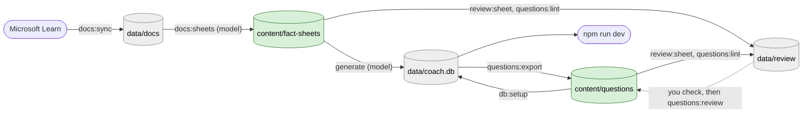

# Scripts

Command-line jobs, each run through `npm run <command>`. The header of every script lists its flags, what it reads and writes, and what it needs. This page is the map.

## Commands

| Command | What it does | Needs | Writes |
|---|---|---|---|
| `db:setup` | Creates the local database from the committed exam data and question bank; `--reset` backs it up and rebuilds it | nothing | `data/coach.db` |
| `docs:sync` | Downloads the Microsoft docs folders the skills link to | git, network | `data/docs/` |
| `docs:sheets` | Writes the fact sheets that are missing or stale | API key (model quota) | **`content/fact-sheets/`**, `data/` logs |
| `docs:review` | Checks each fact-sheet bullet against the Learn page it cites and lists the ones that look wrong | API key (model quota) | `data/review/fact-check/` |
| `generate` | Writes questions until each skill and format reaches its target | API key (model quota) | `data/coach.db`, `data/` logs |
| `generate:stats` | Rejection and flag rates for one area | nothing | nothing (prints) |
| `questions:reverify` | Re-answers a skill's questions from its current fact sheet without the keys and lists the disagreements | API key (one model call) | `data/review/reverify/` |
| `questions:export` | Writes the verified questions from the database to the bank | nothing | **`content/questions/`** |
| `questions:lint` | Structural checks over the bank | nothing | `data/review/lint.md` |
| `review:sheet` | A fact sheet with sample questions, for reviewing a skill | nothing | `data/review/<skill>.md` |
| `questions:review` | Marks a skill's questions reviewed (or not) | nothing | **`content/questions/<skill>.json`** |
| `check:doc-urls` | Checks that every linked Learn page still loads; exits 1 on a dead link | network | nothing |

Bold paths are committed, so their changes show up in `git diff` for review. Everything under `data/` is local and git-ignored. Scripts that open the database use `COACH_DB_PATH` (default `./data/coach.db`).

`flue-jobs.ts` is not a command. It is the shared runner that `generate`, `docs:sheets` and `docs:review` use to run agents several at once and slow down on rate limits.

## How they fit together

Boxes are where data lives and arrows are the commands that move it. Green is committed to git; grey is local and git-ignored. A fresh clone only needs `db:setup`; the rest is for growing and checking the bank.



"(model)" marks the steps that call a model and use your API quota.

`check:doc-urls` can run at any time, for example in CI.

More detail is in the main README: [Setup](../README.md#setup), [Read the docs](../README.md#read-the-docs), [Generate questions](../README.md#generate-questions) and [Question bank](../README.md#question-bank).

## Adding a script

- Add it to `package.json` under `scripts` and to the table above.
- Start it with the standard header:

```ts
// <What it does, in one or two lines.>
//
// Usage: npm run <name> [-- <flags>]
//   --flag <x>   meaning (default)
//
// Reads:  <inputs>
// Writes: <outputs>
// Needs:  <API key in .env (uses model quota) | network | git | nothing>
```
